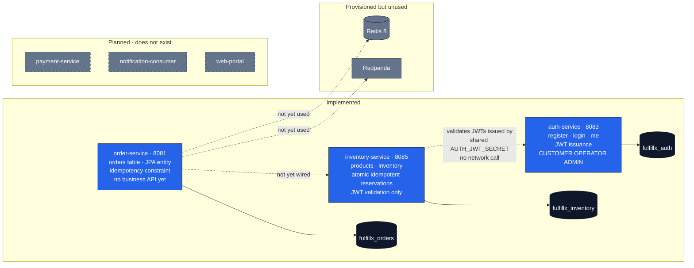
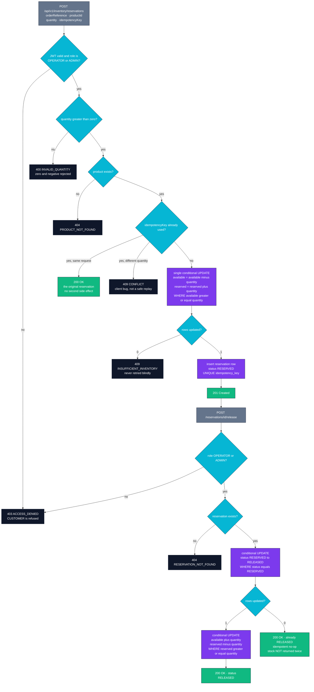

<div align="center">

# 📦 FulfillX

### Distributed-system quality engineering: prove the invariant, don't assert it

**Three Spring Boot services for identity, products and inventory, built so that automated tests
have something real and risky to protect. The headline invariant — inventory can never be oversold —
is proven against real PostgreSQL under actual concurrency, not mocked.
The quality platform is the point; the storefront exists to give it a target.**

[](https://github.com/ckvishwa/fulfillx-enterprise-quality-platform/actions/workflows/pr.yml)
[](https://github.com/ckvishwa/fulfillx-enterprise-quality-platform/actions/workflows/pr.yml)
[](pom.xml)
[](pom.xml)
[](docker-compose.yml)

[](applications/inventory-service/src/test/java/com/fulfillx/inventoryservice/reservation/ConcurrentReservationIntegrationTest.java)
[](applications/)
[](applications/inventory-service/src/main/resources/db/migration/)
[](#-known-limitations)

[Overview](#-overview) · [Problem](#-problem-statement) · [Status](#-implementation-status) · [Architecture](#-system-architecture) · [Reservation lifecycle](#-inventory-reservation-lifecycle) · [Concurrency proof](#-concurrency-proof) · [Security](#-security--reliability) · [Testing](#-testing--quality-assurance) · [Quick start](#-quick-start) · [Limits](#-known-limitations)

</div>

---

## 📌 Overview

| | |
|---|---|
| **What it does** | `auth-service` issues and validates JWTs with a `CUSTOMER`/`OPERATOR`/`ADMIN` role model. `inventory-service` owns products, stock and reservations, with atomic idempotent reservation and role-gated writes. `order-service` holds the orders table and an idempotency constraint. Each service owns a **separate logical database**. |
| **The problem it solves** | "We tested the happy path against an in-memory database" is how overselling reaches production. Every integration test here runs against a real PostgreSQL 18 container via Testcontainers, and the concurrency test exercises 20 genuinely simultaneous requests. |
| **Who benefits** | Anyone evaluating whether I can state a system invariant, choose a mechanism that enforces it at the right layer, and then write the test that would fail if the mechanism were removed. |
| **Why the architecture** | Correctness is pushed into the database. Overselling is prevented by one conditional `UPDATE`, duplicate submission by a `UNIQUE` constraint, and negative stock by `CHECK` constraints — not by application-layer coordination that a second instance would defeat. |

> **This is not a production-ready e-commerce platform.** There is no payment service, no completed
> order API, no web portal, and no end-to-end ordering flow. See
> [Known Limitations](#-known-limitations) before reading anything else as a product claim.

---

## 🎯 Problem Statement

Four failure modes drive the design, and all four are the kind that pass a unit-test suite:

1. **Overselling under concurrency.** Read stock, check it, write it back — and two threads both
   see 1 unit available. Mocks and single-threaded tests never show this. An H2 in-memory database
   often does not either.
2. **Duplicate submission.** A retried request creating a second reservation for the same order is
   indistinguishable from a legitimate second order, unless identity is enforced at the storage
   layer.
3. **Non-idempotent release.** A release that runs twice returns stock twice, silently inflating
   available inventory.
4. **Authorization by assumption.** Before
   [PR #3](https://github.com/ckvishwa/fulfillx-enterprise-quality-platform/pull/3), reservation
   create and release accepted *any authenticated caller*. Because reservations carry no customer
   owner, a `CUSTOMER` could release **another customer's reservation**, or hold stock with no order
   behind it. Being authenticated is not the same as being authorized.

---

## 📍 Implementation Status

Phase 0, Phase 1 (foundation), Phase 2A (identity) and Phase 2B (product & inventory) are
implemented. Everything else is planned.

| Area | Status |
|---|---|
| Repository structure, `CLAUDE.md`, architecture / risk / strategy / traceability docs | ✅ **Implemented** |
| Root Maven reactor + Maven Wrapper (no system Maven required) | ✅ **Implemented** |
| `auth-service` — registration, login, JWT issuance and validation, `CUSTOMER`/`OPERATOR`/`ADMIN`, `/me` | ✅ **Implemented** — 16 tests |
| `inventory-service` — products, inventory, atomic idempotent reservations, JWT validation, role gates | ✅ **Implemented** — 42 tests |
| `order-service` — Spring Boot skeleton, Actuator health, `orders` table (Flyway), JPA entity, idempotency constraint | ✅ **Implemented** — 3 tests |
| `docker-compose.yml` — PostgreSQL 18 (three logical databases), Redis 8, Redpanda | ✅ **Implemented**, validated healthy locally |
| GitHub Actions PR pipeline — Java 21, Maven cache, `./mvnw clean verify`, full reactor | ✅ **Implemented and GitHub-validated** — green on `main` |
| Redis 8 and Redpanda | ⬜ Provisioned but **not yet used by any service** |
| `order-service` business API (create / confirm / query an order) | ⬜ **Planned — does not exist** |
| Payment service, notification consumer, web portal | ⬜ **Planned — does not exist** |
| End-to-end ordering flow (register → order → pay → confirm → event → audit) | ⬜ **Planned — does not exist** |
| Service-to-service authentication | ⬜ **Planned** — `OPERATOR`/`ADMIN` stand in today |
| API automation (REST Assured), UI automation (Playwright), contract tests (Pact), event tests, performance tests (k6) | ⬜ **Planned** |
| Seeded defects FX-001…FX-008 | ⬜ **Planned** |
| Outbox pattern, service containerization, order state-transition guards | ⬜ **Not implemented** |

---

## 🧱 System Architecture



**Three separate logical databases with no physical foreign key between them, by design.**
`customer_id` in `order-service` is not an FK to `auth-service`'s users — see
[ADR-002](docs/decisions/ADR-002-identity-and-cross-service-data-ownership.md). `inventory-service`
validates JWTs locally using the shared `AUTH_JWT_SECRET`; it never calls `auth-service` and never
issues a token itself.

---

## 🔄 Inventory Reservation Lifecycle

Every decision point below is enforced by the database or by Spring Security, not by application
bookkeeping.



### The three guards that make this safe

| Guard | Statement | What it prevents |
|---|---|---|
| **Atomic conditional reserve** | `SET available = available - :q, reserved = reserved + :q WHERE productId = :id AND available >= :q` | Overselling. There is **no read-then-check-then-write in application code** — PostgreSQL's row-level locking under this single `UPDATE` serialises concurrent attempts. A return of `0` rows means insufficient inventory and is never retried blindly. |
| **Atomic conditional release** | `SET available = available + :q, reserved = reserved - :q WHERE productId = :id AND reserved >= :q` | `reserved_quantity` going negative, even under a concurrent double-release. |
| **Guarded status transition** | `SET status = RELEASED WHERE id = :id AND status = RESERVED` | Returning stock twice. Only one concurrent or repeated release can win this race; `0` rows updated means "already released" and is a safe no-op once existence is confirmed. |

### Database-enforced invariants

From [`V1__create_product_and_inventory_tables.sql`](applications/inventory-service/src/main/resources/db/migration/V1__create_product_and_inventory_tables.sql) — these hold regardless of what any service does:

| Constraint | Guarantee |
|---|---|
| `ck_inventory_items_available_nonnegative` | `available_quantity >= 0` |
| `ck_inventory_items_reserved_nonnegative` | `reserved_quantity >= 0` |
| `uq_inventory_reservations_idempotency_key` | One reservation per idempotency key |
| `ck_inventory_reservations_status` | `status IN ('RESERVED', 'RELEASED')` |
| `ck_inventory_reservations_quantity_positive` | `quantity > 0` |
| `uq_products_sku` | SKU uniqueness |
| `ck_products_sku_normalized` | SKU is upper-case and trimmed and non-empty |
| `ck_products_price_nonnegative` | `price_minor >= 0` |
| `ck_products_currency_format` | `currency ~ '^[A-Z]{3}$'` |

Note the row-version column: every conditional `UPDATE` also increments `version` and `updated_at`.

---

## 🧪 Concurrency Proof

[`ConcurrentReservationIntegrationTest`](applications/inventory-service/src/test/java/com/fulfillx/inventoryservice/reservation/ConcurrentReservationIntegrationTest.java),
against a real `postgres:18-alpine` container:

| Parameter | Value |
|---|---|
| `CONCURRENT_ATTEMPTS` | **20** |
| `INITIAL_STOCK` | **5** |
| `EXPECTED_SUCCESSES` | **5** |
| Synchronisation | `CyclicBarrier(20)` across a 20-thread pool, so all attempts are released together |
| Per-attempt bound | `future.get(5, TimeUnit.SECONDS)` |

Three assertions, all of which must hold:

1. Exactly **5** attempts return `201 Created`.
2. Exactly **15** (`CONCURRENT_ATTEMPTS - EXPECTED_SUCCESSES`) return `409 INSUFFICIENT_INVENTORY`.
3. Exactly **5** reservation rows exist — one per successful attempt, queried back from the database.

Twenty simultaneous one-unit attempts against five units of stock yield exactly five successes and
fifteen controlled failures. **Never more.** Remove the `AND available >= :q` guard and this test
fails, which is the point of it.

The idempotency behaviour is proven separately in
[`ReservationApiIntegrationTest`](applications/inventory-service/src/test/java/com/fulfillx/inventoryservice/reservation/ReservationApiIntegrationTest.java):
a replayed key returns `200` with the *same* reservation id and no additional side effect; the same
key with a different quantity returns `409`; a repeated release returns `200` without restoring
stock a second time.

---

## 🔒 Security & Reliability

### Authorization matrix — as enforced in `SecurityConfig`

| Endpoint | Required role |
|---|---|
| `GET /actuator/health`, `/actuator/health/**`, `/actuator/info` | public |
| `POST /api/v1/products` | `ADMIN` |
| `POST /api/v1/inventory/{productId}/adjust` | `ADMIN` |
| `POST /api/v1/inventory/reservations` | **`OPERATOR` or `ADMIN`** |
| `POST /api/v1/inventory/reservations/{id}/release` | **`OPERATOR` or `ADMIN`** |
| Product and inventory reads | any authenticated caller |

The reservation restriction landed in
[PR #3](https://github.com/ckvishwa/fulfillx-enterprise-quality-platform/pull/3). Reservations carry
**no customer owner**, so "any authenticated caller" allowed a `CUSTOMER` to release another
customer's reservation or hold stock with no order behind it.
[`ReservationAuthorizationTest`](applications/inventory-service/src/test/java/com/fulfillx/inventoryservice/reservation/ReservationAuthorizationTest.java)
and `ReservationApiIntegrationTest` now prove a `CUSTOMER` receives `403 ACCESS_DENIED` on both
endpoints, and that a denied release leaves `availableQuantity` and `reservedQuantity` untouched.

> **`OPERATOR` and `ADMIN` currently stand in for the trusted internal service.** There is no
> service-to-service authentication mechanism yet, and `order-service` — the eventual real caller —
> has no endpoint of its own to call from. This is an authorization gap that is narrowed, not
> closed. See [ADR-003](docs/decisions/ADR-003-inventory-consistency-and-atomic-reservation.md) and
> `CLAUDE.md` section 16.

### Controls that exist

| Control | Implementation |
|---|---|
| **Authentication** | Password hashing in `auth-service`; bounded-lifetime JWTs |
| **Authorization** | Role-gated endpoints per the matrix above; `CUSTOMER`/`OPERATOR`/`ADMIN` |
| **Token validation** | `inventory-service` validates only; it never issues JWTs |
| **Input validation** | Quantity must be positive; stock adjustment rejects a negative delta as `INVALID_QUANTITY`; SKU, price and currency are constrained in-database |
| **Data integrity** | `CHECK` constraints make negative available or reserved stock unrepresentable |
| **Idempotency** | `UNIQUE (idempotency_key)`; replay returns the original, conflicting reuse returns `409` |
| **Concurrency safety** | Single conditional `UPDATE` per state change; row-version increment on every write |
| **Failure handling** | Named error codes (`INVALID_QUANTITY`, `PRODUCT_NOT_FOUND`, `INSUFFICIENT_INVENTORY`, `RESERVATION_NOT_FOUND`, `ACCESS_DENIED`); `RestAuthenticationEntryPoint` and `RestAccessDeniedHandler` return structured JSON rather than HTML error pages |
| **Schema control** | Flyway versioned migrations per service |
| **Test realism** | Testcontainers PostgreSQL 18 — no in-memory substitute |
| **Least-privilege CI** | `pr.yml` runs with read-only `contents` permission |

**Not implemented:** service-to-service authentication, JWT revocation before natural expiry, an
endpoint to provision `OPERATOR`/`ADMIN` accounts, order state-transition guards (only valid
*values* are enforced, not valid *transitions*), an outbox pattern, rate limiting, and audit
logging.

---

## 🧪 Testing & Quality Assurance

**61 tests**, all passing on hosted CI
([`pr.yml`](.github/workflows/pr.yml), full reactor, Java 21, `ubuntu-latest`).

| Service | Tests | Modules |
|---|---|---|
| `order-service` | **3** | `OrderPersistenceIntegrationTest` (3) |
| `auth-service` | **16** | `AuthApiIntegrationTest` (13), `JwtServiceTest` (3) |
| `inventory-service` | **42** | `ReservationApiIntegrationTest` (13), `ProductApiIntegrationTest` (10), `InventoryApiIntegrationTest` (9), `ReservationAuthorizationTest` (5), `JwtServiceTest` (4), `ConcurrentReservationIntegrationTest` (1) |
| **Total** | **61** | |

| Category | What it proves |
|---|---|
| **Concurrency** | 20 simultaneous attempts against 5 units yield exactly 5 successes, 15 conflicts, 5 rows |
| **Idempotency** | Replayed key returns the original reservation; conflicting reuse is `409`; repeated release is a no-op |
| **Authorization** | `CUSTOMER` is refused on reservation create and release, and stock is unchanged by the refusal |
| **Persistence integrity** | Real PostgreSQL via Testcontainers; Flyway migrations applied per test container |
| **Validation** | Zero and negative quantities, unknown products, unknown reservations |
| **JWT** | Issuance and validation, including rejection paths |

```bash
./mvnw -B clean verify          # full reactor; requires Docker for Testcontainers
```

**Not present yet:** REST Assured API suites, Playwright UI suites, Pact contract tests, event
tests, k6 performance tests, Allure reports, and the seeded defects FX-001…FX-008.

---

## 🚀 Quick Start

Requires Java 21, Docker Desktop (or equivalent) and Git. **No system Maven install** — the repo
ships the Maven Wrapper.

```bash
# 1. Local-only environment defaults (not real secrets)
cp .env.example .env

# 2. Infrastructure: PostgreSQL 18 with three logical databases, Redis 8, Redpanda
docker compose up -d
docker compose ps        # all services should report healthy

# 3. Run the services
cd applications/auth-service      && ../../mvnw spring-boot:run   # 8083
cd applications/inventory-service && ../../mvnw spring-boot:run   # 8085 — needs the same AUTH_JWT_SECRET
cd applications/order-service     && ../../mvnw spring-boot:run   # 8081

curl http://localhost:8083/actuator/health
curl http://localhost:8085/actuator/health
curl http://localhost:8081/actuator/health

# 4. Register, log in, call an authenticated endpoint
curl -X POST http://localhost:8083/api/v1/auth/register \
  -H 'Content-Type: application/json' \
  -d '{"email":"demo@example.com","password":"correct-horse-battery"}'

curl -X POST http://localhost:8083/api/v1/auth/login \
  -H 'Content-Type: application/json' \
  -d '{"email":"demo@example.com","password":"correct-horse-battery"}'

curl http://localhost:8083/api/v1/auth/me -H "Authorization: Bearer <accessToken>"

# 5. Tear down
docker compose down       # add -v to remove data volumes too
```

> If your `postgres-data` volume predates the `fulfillx_auth` (Phase 2A) or `fulfillx_inventory`
> (Phase 2B) databases, run `docker compose down -v` once — the database-creation scripts only run
> against a fresh volume.

> **Reservation endpoints need an `OPERATOR` or `ADMIN` token.** There is **no endpoint to provision
> those accounts yet**, so exercising reservations by hand currently requires promoting a user
> directly in `fulfillx_auth`. The automated tests mint their own tokens via `TestTokens`.

---

## 📂 Repository Structure

```text
fulfillx-enterprise-quality-platform/
├── applications/
│   ├── auth-service/           # registration, login, JWT issuance, /me
│   ├── inventory-service/
│   │   ├── product/            # product API
│   │   ├── inventory/          # InventoryItemRepository: the atomic conditional UPDATEs
│   │   ├── reservation/        # ReservationController, atomic status transition
│   │   ├── security/           # SecurityConfig role gates, JwtService, error handlers
│   │   └── resources/db/migration/   # Flyway: tables, CHECK and UNIQUE constraints
│   └── order-service/          # orders table, JPA entity, idempotency constraint
├── infrastructure/
├── docs/
│   ├── architecture/           # diagrams, trust boundaries
│   ├── decisions/              # ADR-002 data ownership, ADR-003 atomic reservation
│   ├── business-risks/         # business-risk-register.md
│   └── roadmap/                # phased-delivery-plan.md
├── docker-compose.yml          # PostgreSQL 18 (3 DBs), Redis 8, Redpanda
├── CLAUDE.md                   # operating contract, section 16 = known limitations
├── pom.xml · mvnw · mvnw.cmd   # root reactor + Maven Wrapper
└── .github/workflows/pr.yml    # full-reactor build and test
```

---

## 🧠 Engineering Decisions

| Decision | Reasoning | Rejected alternative |
|---|---|---|
| Enforce stock with one conditional `UPDATE` | The database is the only serialisation point every instance shares. Read-then-write in application code is wrong the moment a second replica exists | Optimistic locking with retry, or a distributed lock in Redis — more moving parts, and both still need the DB guard to be correct |
| `CHECK` constraints for non-negative stock | Makes the invalid state unrepresentable rather than merely untested | Service-layer validation only |
| `UNIQUE (idempotency_key)` instead of an application cache | A cache miss silently permits a duplicate; a unique index cannot | Redis-backed idempotency |
| Guarded status transition for release | Returning stock twice is the subtle bug; a `WHERE status = RESERVED` clause makes repeated release a no-op by construction | Checking status in Java, then updating |
| Separate logical databases, no cross-service FK | Enforces the service boundary structurally — see ADR-002 | One shared schema with real foreign keys |
| Testcontainers PostgreSQL 18, not H2 | The concurrency behaviour under test *is* PostgreSQL row-locking behaviour; H2 would prove nothing | H2 in-memory for speed |
| `CyclicBarrier` rather than just a thread pool | A pool alone staggers requests; the barrier makes them genuinely simultaneous, which is what the race needs | Submitting 20 tasks and hoping they overlap |
| `OPERATOR`/`ADMIN` as the interim gate for reservations | Narrowing from "any authenticated caller" is a real reduction in exposure, available today; waiting for service-to-service auth would have left the hole open | Leaving it open until the proper mechanism exists |
| Validate JWTs locally in `inventory-service` | No network dependency on `auth-service` for every request | Introspection call per request |

---

## 🚧 Known Limitations

Nothing below is hidden behind marketing language.

- **Not a production-ready e-commerce platform.** It is a quality-engineering demonstrator.
- **`order-service` exposes no completed order API** — it has the table, the JPA entity, the
  idempotency constraint and a health endpoint. There is no create / confirm / query order endpoint.
- **Payment is not implemented**, and neither is the end-to-end ordering flow (register → order →
  pay → confirm → event → audit).
- **`OPERATOR` and `ADMIN` stand in for the trusted internal service.** Service-to-service
  authentication **remains future work**; `order-service` has no caller-side endpoint to call from.
- **No endpoint provisions `OPERATOR`/`ADMIN` accounts** — they must be set directly in the database.
- **JWTs are not revocable** before their short, bounded natural expiry.
- **Order state *transitions* are not guarded** — only valid state *values* are enforced.
- **No outbox pattern**, so there is no transactional guarantee between a database write and an
  event publish.
- **Redis 8 and Redpanda are provisioned but unused** by any service.
- **No service is containerized yet** — they run from the Maven Wrapper against Compose
  infrastructure.
- **`customer_id` has no physical foreign key**, by design (ADR-002, separate databases).
- **Stock adjustment only increases stock** in this phase; a negative delta is rejected as
  `INVALID_QUANTITY`.
- **No web portal, no UI, and no UI tests.**
- **Seeded defects FX-001…FX-008 do not exist yet**, so no detection-rate claim can be made.
- **The concurrency proof is one scenario** — 20 attempts against 5 units on one product. It does
  not characterise behaviour at scale, across products, or under sustained load.

---

## 🧭 Roadmap

From [`docs/roadmap/phased-delivery-plan.md`](docs/roadmap/phased-delivery-plan.md). None of this is
implemented.

| Planned | Closes |
|---|---|
| **Phase 2 — first complete vertical slice** (register → order → payment → confirm → event → audit) | Wires `order-service` to `inventory-service` and gives the reservation API a real caller |
| Service-to-service authentication | Replaces the `OPERATOR`/`ADMIN` stand-in and closes the authorization gap |
| `order-service` business API | The missing create / confirm / query endpoints |
| Payment service and notification consumer | Duplicate payment authorization, payment uncertainty after timeout, unauthorized refunds |
| Outbox pattern + Redpanda event flow | Duplicate and out-of-order delivery, poison messages, consumer-restart recovery |
| REST Assured, Playwright, Pact, k6 suites | API, UI, contract and performance coverage |
| Seeded defects FX-001…FX-008 | Lets the test suite's detection power be measured rather than asserted |

---

## 📚 Evidence & Documentation

| Document | Contents |
|---|---|
| [`CLAUDE.md`](CLAUDE.md) | Operating contract; **section 16** is the full current limitations list |
| [`ADR-002`](docs/decisions/ADR-002-identity-and-cross-service-data-ownership.md) | Identity and cross-service data ownership — why there is no cross-service FK |
| [`ADR-003`](docs/decisions/ADR-003-inventory-consistency-and-atomic-reservation.md) | Atomic-reservation design and its consequences |
| [`docs/business-risks/business-risk-register.md`](docs/business-risks/business-risk-register.md) | RISK-01 overselling, RISK-02 duplicate submission, RISK-07 unauthorized access, and the rest |
| [`docs/architecture/`](docs/architecture/) | Diagrams, target architecture, trust boundaries |
| [`docs/roadmap/phased-delivery-plan.md`](docs/roadmap/phased-delivery-plan.md) | Full phase sequence |
| [`ConcurrentReservationIntegrationTest`](applications/inventory-service/src/test/java/com/fulfillx/inventoryservice/reservation/ConcurrentReservationIntegrationTest.java) | The overselling proof |
| [`ReservationAuthorizationTest`](applications/inventory-service/src/test/java/com/fulfillx/inventoryservice/reservation/ReservationAuthorizationTest.java) | The authorization proof |
| [`InventoryItemRepository`](applications/inventory-service/src/main/java/com/fulfillx/inventoryservice/inventory/InventoryItemRepository.java) | The three atomic conditional `UPDATE` statements |
| [`V1__create_product_and_inventory_tables.sql`](applications/inventory-service/src/main/resources/db/migration/V1__create_product_and_inventory_tables.sql) | Every database-enforced invariant |
| [PR #3](https://github.com/ckvishwa/fulfillx-enterprise-quality-platform/pull/3) | The authorization fix and its CI run |
| [`pr.yml`](.github/workflows/pr.yml) | The exact build behind the 61-test figure |

---

## 👨‍💻 Author

**Vishva Teja Chikoti** — Cybersecurity · Security Engineering · QA Automation
M.S. Cybersecurity & Networks, University of New Haven (Aug 2023 – Dec 2025) · CompTIA Security+

[](https://github.com/ckvishwa)
[](https://linkedin.com/in/vishvack)
[](mailto:vishvatejack@gmail.com)
